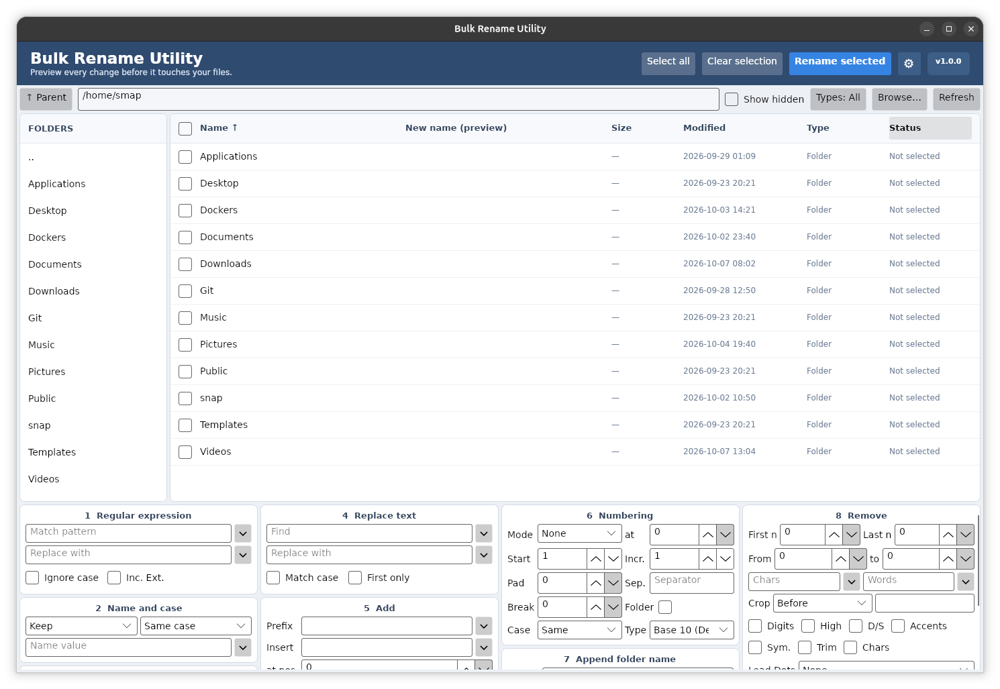

# Bulk Rename Utility for Linux

A preview-first desktop application for batch filename changes, based on the
workflow of the classic Bulk Rename Utility. The interface is built with
Avalonia and targets .NET 10.



## Current functionality

- Browse folders and inspect names, sizes, types, and modified times.
- Preview text replacement (the Find field accepts `*` as a wildcard), regular expressions, removing text (first/last n characters, a position range, characters, words, crop before/after text, digits, high characters, double spaces, accents, symbols, trimming and leading dots), case changes,
  fixed/prefixed/suffixed names, numbering, adding prefix/suffix/inserted text, appending parent folder names, and
  extension case changes.
- Select individual entries or all entries; only checked items are changed.
- Validate destinations before changes and stage items through temporary names
  to support safe swaps and restore original names if the operation fails.

## Build and run

Install the .NET 10 SDK, then run:

```sh
dotnet build BulkRenameUtility.sln --configuration Release
dotnet run --project src/BulkRenameUtility/BulkRenameUtility.csproj
```

Avalonia uses X11/XWayland by default on Linux. Install the system's X11 runtime
dependencies if the application does not start from a minimal environment.

## Linux packages

All builds target x86_64 Linux and bundle the .NET runtime. Build each package on its target distribution, then attach the files from `artifacts/` to a GitHub Release so the download links work. The scripts default to version `1.0.1`; set `VERSION` to override it.

| Package | Build command | Local output path | Download |
| --- | --- | --- | --- |
| Debian/Ubuntu (.deb) | `bash packaging/debian/build-deb.sh` | `artifacts/debian/bulk-rename-utility_1.0.1_amd64.deb` | [Download .deb](https://github.com/SMAP-git/Bulk_Rename_Utility_Linux/releases/latest/download/bulk-rename-utility_1.0.1_amd64.deb) |
| Fedora (.rpm) | `bash packaging/fedora/build-rpm.sh` | `artifacts/fedora/bulk-rename-utility-1.0.1-1.x86_64.rpm` | [Download .rpm](https://github.com/SMAP-git/Bulk_Rename_Utility_Linux/releases/latest/download/bulk-rename-utility-1.0.1-1.x86_64.rpm) |
| Arch Linux (.pkg.tar.gz) | `bash packaging/arch/build-arch.sh` | `artifacts/arch/bulk-rename-utility-1.0.1-1-x86_64.pkg.tar.gz` | [Download Arch package](https://github.com/SMAP-git/Bulk_Rename_Utility_Linux/releases/latest/download/bulk-rename-utility-1.0.1-1-x86_64.pkg.tar.gz) |
| Flatpak | `bash packaging/flatpak/build-flatpak.sh` | `artifacts/flatpak/io.github.smapgit.bulkrenameutility.flatpak` | [Download Flatpak](https://github.com/SMAP-git/Bulk_Rename_Utility_Linux/releases/latest/download/io.github.smapgit.bulkrenameutility.flatpak) |

Release asset names must match the file names above. The Flatpak build needs Flatpak Builder and the Freedesktop 26.08 SDK/runtime; its app listing is `packaging/flatpak/io.github.smapgit.bulkrenameutility.metainfo.xml`.

## Docker and Unraid

Build the Debian package, then run `bash packaging/docker/build-docker.sh` to create the local `bulk-rename-utility:1.0.1` image with TigerVNC and a browser WebUI on port `6081`. VNC authentication is optional; no-password access is unsafe on untrusted networks. To publish the image to GitHub Container Registry after creating a release with the `.deb` attached, run `gh workflow run publish-docker.yml --repo SMAP-git/Bulk_Rename_Utility_Linux -f version=1.0.1`, then pull `ghcr.io/smap-git/bulk-rename-utility:1.0.1`.

For Unraid, use the [container template](packaging/docker/unraid-template.xml) and see [the Docker guide](packaging/docker/README.md) for mounts and network safety.

## Languages

Use **Language** in the top menu to switch the interface. Language catalogs are
JSON files in `src/BulkRenameUtility/Languages/`, using the language set from
gMKVExtractGUI: German, Greek, English, Estonian, French, Hindi, Hungarian,
Italian, Japanese, Korean, Dutch, Polish, Brazilian Portuguese, Portuguese,
Romanian, Russian, Turkish, Simplified Chinese, and Traditional Chinese. The
selected language applies immediately and lasts for the current app session;
the app starts in English after restart.

## Why .NET 10

.NET 10 is the better starting point for a new app: it is an LTS release
supported until **November 14, 2028**, while .NET 8 support ends **November 10,
2026**. It gives this project a longer supported runway without changing the
Avalonia GUI or Linux packaging approach. Linux packages bundle the .NET
runtime, so users do not need to install .NET separately.

References:

- [.NET support policy](https://dotnet.microsoft.com/en-us/platform/support/policy/dotnet-core)
- [Avalonia Linux platform guide](https://docs.avaloniaui.net/docs/platform-specific-guides/linux)
- [Flatpak .NET guide](https://docs.flatpak.org/en/latest/dotnet.html)

## Settings

The selected language and theme (Follow the system, Light or Dark) are saved in `~/.config/bulk-rename-utility/settings.json` and restored on start.

## License

Released into the public domain under [The Unlicense](LICENSE).
